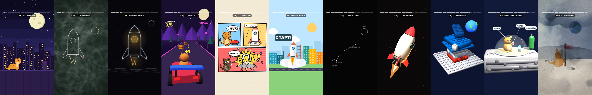

# Стили анимации — скилл для Claude

Короткие анимированные ролики **кодом** в 11 стилях: из сценария или идеи в одну строку получается вертикальное видео 9:16 (Reels, Shorts, TikTok). Ролик — один HTML-файл: сцены рисуются на холсте (Canvas 2D, three.js, p5.brush), а встроенный плеер проигрывает их и записывает MP4 прямо в браузере.



## Стили

| # | Стиль | Как выглядит |
|---|---|---|
| 1 | **Pixel Art** | ретро-игра 8/16 бит, ограниченная палитра, дизеринг |
| 2 | **Chalkboard** | мел на школьной доске, всё рисуется на глазах |
| 3 | **Glow Sketch** | светящиеся пунктирные контуры на тёмном, золотой акцент |
| 4 | **Retro 3D** | лоу-поли 3D игр начала 2000-х: пиксели, туман, сканлайны, HUD |
| 5 | **Comic Art** | комикс: панели, растр, звукопись «БАМ!», пузыри |
| 6 | **Flat Vector** | плоская иллюстрация и инфографика без обводок |
| 7 | **Mono Lines** | минимализм: тонкие белые линии и схемы на чёрном |
| 8 | **CGI Motion** | рекламный 3D-пэкшот: глянец, студийный свет, облёт камеры |
| 9 | **Brick Build** | мир из пластиковых кубиков, которые падают и защёлкиваются |
| 10 | **Clay Explainer** | пластилиновая 3D-объяснялка в разрезе с подписями-выносками |
| 11 | **Watercolor** | живая акварель на бумаге: растекания, карандаш, уголь |

Пример: [`assets/examples/kot_na_lune_11_styles.mp4`](assets/examples/kot_na_lune_11_styles.mp4) — история «Кот, который полетел на Луну», все 11 стилей по 3 секунды. Исходник рядом, в `kot_na_lune_11_styles.html`.

## Установка

Скопируй папку репозитория в папку скиллов Claude под именем `stili-animacii`:

```bash
git clone https://github.com/meke98sad-alt/stili-animacii ~/.claude/skills/stili-animacii
```

На Windows путь тот же: `C:\Users\<имя>\.claude\skills\stili-animacii`.
В claude.ai можно загрузить скилл архивом: Настройки → Возможности → Скиллы.

## Как пользоваться

Напиши Claude, например:

> Сделай ролик в стиле Comic Art: кот толкает кружку со стола — БАМ!

> Chalkboard: как работает фотосинтез, 15 секунд

Claude распишет раскадровку, напишет HTML и (если может выполнять код) проверит кадры. Дальше открой HTML в браузере: ▶ — посмотреть, «Скачать видео» — записать MP4.

## Проверка и рендер без браузерной записи

Нужны Node.js 22+ и Edge или Chrome; для MP4 — ffmpeg.

```bash
node scripts/preview-edge.mjs --html ролик.html --out ./out          # кадры на 10/40/90% каждой сцены
node scripts/preview-edge.mjs --html ролик.html --out ./out --mp4    # полный MP4
```

`scripts/render.mjs` делает то же через Playwright, если он установлен.

## Что внутри

```
SKILL.md                     — инструкция для Claude
references/workflow.md       — раскадровка, тайминг, компоновка 9:16, проверка
references/styles/*.md       — правила каждого стиля
assets/player_template.html  — плеер с библиотекой кистей и записью видео
assets/examples/             — примеры роликов
scripts/                     — превью и рендер в MP4
```

## Лицензия

MIT — см. [LICENSE](LICENSE). Используемые библиотеки: [three.js](https://threejs.org) (MIT), [p5.brush](https://github.com/acamposuribe/p5.brush) (MIT), шрифты Inter, Lora, Press Start 2P (OFL).
Названия стилей описывают приёмы, а не чьи-то бренды: не используй в роликах чужие логотипы и торговые марки.
